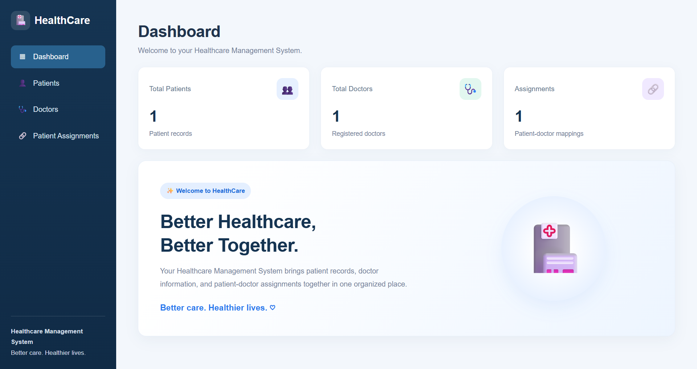

<h1 align="center">🏥 Healthcare Backend API</h1>

<p align="center">
A healthcare management application built with Django, Django REST Framework, and PostgreSQL. It provides REST APIs for user authentication, patient management, doctor management, and patient-doctor assignments, along with a simple Bootstrap-based web interface.
</p>

## 📸 Dashboard Preview



<h2>📌 Table of Contents</h2>

<p align="center">
<a href="#features">Features</a> •
<a href="#tech-stack">Tech Stack</a> •
<a href="#project-structure">Project Structure</a> •
<a href="#api-endpoints">API Endpoints</a> •
<a href="#authentication">Authentication</a> •
<a href="#installation">Installation</a> •
<a href="#testing">Testing</a> •
<a href="#what-i-learned">What I Learned</a>
</p>

---

<h2 id="features">Features</h2>

<h3>User Authentication</h3>

- User Registration
- User Login
- JWT Access and Refresh Tokens
- Secure password handling
- Authentication-protected API endpoints

<h3>Patient Management</h3>

- Create patients
- View authenticated user's patients
- View individual patient details
- Update patient information
- Delete patients
- Patient ownership based on authenticated user

<h3>Doctor Management</h3>

- Create doctors
- View doctors
- View individual doctor details
- Update doctor information
- Delete doctors
- Doctor specialization and contact information

<h3>Patient-Doctor Mapping</h3>

- Assign doctors to patients
- View mappings
- View mappings for a specific patient
- Delete patient-doctor mappings
- Prevent unauthorized users from assigning doctors to other users' patients

<h3>Security & Validation</h3>

- JWT authentication
- Protected REST API endpoints
- Permission-based access control
- Serializer-based validation
- Environment variables for sensitive database configuration
- PostgreSQL database

---

<h2 id="tech-stack">Tech Stack</h2>

<h3>Backend</h3>

- Python
- Django
- Django REST Framework

<h3>Database</h3>

- PostgreSQL

<h3>Authentication</h3>

- JSON Web Token (JWT)
- djangorestframework-simplejwt

<h3>Frontend</h3>

- HTML
- CSS
- Bootstrap
- JavaScript

<h3>Other Technologies</h3>

- Django ORM
- python-dotenv
- Postman for API testing
- Git & GitHub

---

<h2 id="project-structure">Project Structure</h2>

```text
healthcare_backend/
│
├── accounts/
│   ├── migrations/
│   ├── __init__.py
│   ├── admin.py
│   ├── apps.py
│   ├── models.py
│   ├── serializers.py
│   ├── tests.py
│   ├── urls.py
│   └── views.py
│
├── doctors/
│   ├── migrations/
│   ├── __init__.py
│   ├── admin.py
│   ├── apps.py
│   ├── models.py
│   ├── serializers.py
│   ├── tests.py
│   ├── urls.py
│   └── views.py
│
├── frontend/
│   ├── migrations/
│   ├── static/
│   │   └── style.css
│   ├── templates/
│   │   └── frontend/
│   │       ├── dashboard.html
│   │       ├── doctors.html
│   │       ├── mappings.html
│   │       └── patients.html
│   ├── __init__.py
│   ├── admin.py
│   ├── apps.py
│   ├── models.py
│   ├── tests.py
│   ├── urls.py
│   └── views.py
│
├── healthcare/
│   ├── __init__.py
│   ├── asgi.py
│   ├── settings.py
│   ├── urls.py
│   └── wsgi.py
│
├── mappings/
│   ├── migrations/
│   ├── __init__.py
│   ├── admin.py
│   ├── apps.py
│   ├── models.py
│   ├── serializers.py
│   ├── tests.py
│   ├── urls.py
│   └── views.py
│
├── patients/
│   ├── migrations/
│   ├── __init__.py
│   ├── admin.py
│   ├── apps.py
│   ├── models.py
│   ├── serializers.py
│   ├── tests.py
│   ├── urls.py
│   └── views.py
│
├── .env
├── .gitignore
├── manage.py
├── README.md
└── requirements.txt
```

<h2 id="api-endpoints">API Endpoints</h2>

<h3>Authentication</h3>

| Method | Endpoint | Description |
| ------ | -------- | ----------- |
| POST | `/api/auth/register/` | Register a new user |
| POST | `/api/auth/login/` | Login and obtain JWT tokens |

<h3>Patients</h3>

| Method | Endpoint | Description |
| ------ | -------- | ----------- |
| POST | `/api/patients/` | Create a patient |
| GET | `/api/patients/` | List authenticated user's patients |
| GET | `/api/patients/<id>/` | Retrieve a patient |
| PUT | `/api/patients/<id>/` | Update a patient |
| DELETE | `/api/patients/<id>/` | Delete a patient |

<h3>Doctors</h3>

| Method | Endpoint | Description |
| ------ | -------- | ----------- |
| POST | `/api/doctors/` | Create a doctor |
| GET | `/api/doctors/` | List doctors |
| GET | `/api/doctors/<id>/` | Retrieve a doctor |
| PUT | `/api/doctors/<id>/` | Update a doctor |
| DELETE | `/api/doctors/<id>/` | Delete a doctor |

<h3>Patient-Doctor Mappings</h3>

| Method | Endpoint | Description |
| ------ | -------- | ----------- |
| POST | `/api/mappings/` | Assign a doctor to a patient |
| GET | `/api/mappings/` | List mappings |
| GET | `/api/mappings/<patient_id>/` | Get mappings for a patient |
| DELETE | `/api/mappings/<id>/` | Delete a mapping |

---

<h2 id="authentication">Authentication</h2>

<p>
The API uses JWT authentication through <strong>djangorestframework-simplejwt</strong>.
</p>

<p>
After successful login, the API returns an access token and a refresh token.
</p>

<p>
Protected endpoints require the JWT access token.
</p>

In Postman:

<strong>Authorization → Bearer Token → <code>&lt;access_token&gt;</code></strong>

---

<h2 id="installation">Installation</h2>

<h3>1. Clone the Repository</h3>

```bash
git clone https://github.com/vaidyajanhavi13-bot/backend-healthcare-django
```

<h3>2. Navigate to the Project Folder</h3>

```bash
cd healthcare_backend
```

<h3>3. Create a Virtual Environment</h3>

```bash
python -m venv venv
```

<h3>4. Activate the Virtual Environment</h3>

<strong>Windows</strong>

```bash
venv\Scripts\activate
```

<strong>Linux / macOS</strong>

```bash
source venv/bin/activate
```

<h3>5. Install Dependencies</h3>

```bash
pip install -r requirements.txt
```

<h3>6. Configure Environment Variables</h3>

Create a `.env` file in the project root:

```env
SECRET_KEY=your-secret-key
DEBUG=True
DB_NAME=healthcare_db
DB_USER=postgres
DB_PASSWORD=your-postgres-password
DB_HOST=localhost
DB_PORT=5432
```

<h3>7. Apply Database Migrations</h3>

```bash
python manage.py migrate
```

<h3>8. Start the Development Server</h3>

```bash
python manage.py runserver
```

The API will be available at:

http://127.0.0.1:8000/

---

<h2 id="testing">Testing</h2>

The API endpoints were tested using <strong>Postman</strong>.

Tested functionality includes:

- User registration
- User login
- JWT authentication
- Patient creation and retrieval
- Patient update and deletion
- Doctor creation and retrieval
- Doctor update and deletion
- Patient-doctor mapping creation
- Mapping retrieval
- Mapping deletion
- Authentication-protected endpoints
- Permission checks for patient ownership

---

<h2 id="what-i-learned">What I Learned</h2>

While building this project, I gained practical experience with:

- Django REST Framework
- REST API development
- JWT authentication
- Custom Django user models
- Django ORM
- PostgreSQL integration
- CRUD operations
- Model relationships
- Serializers and validation
- Authentication and permissions
- Environment variable management
- API testing with Postman
- Git & GitHub

---

<h2 id="author">Author</h2>

<strong>Janhavi Vaidya</strong>

<a href="https://github.com/vaidyajanhavi13-bot">GitHub Profile</a>

<a href="https://www.linkedin.com/in/janhavi-vaidya-79b8b4333">LinkedIn Profile</a>